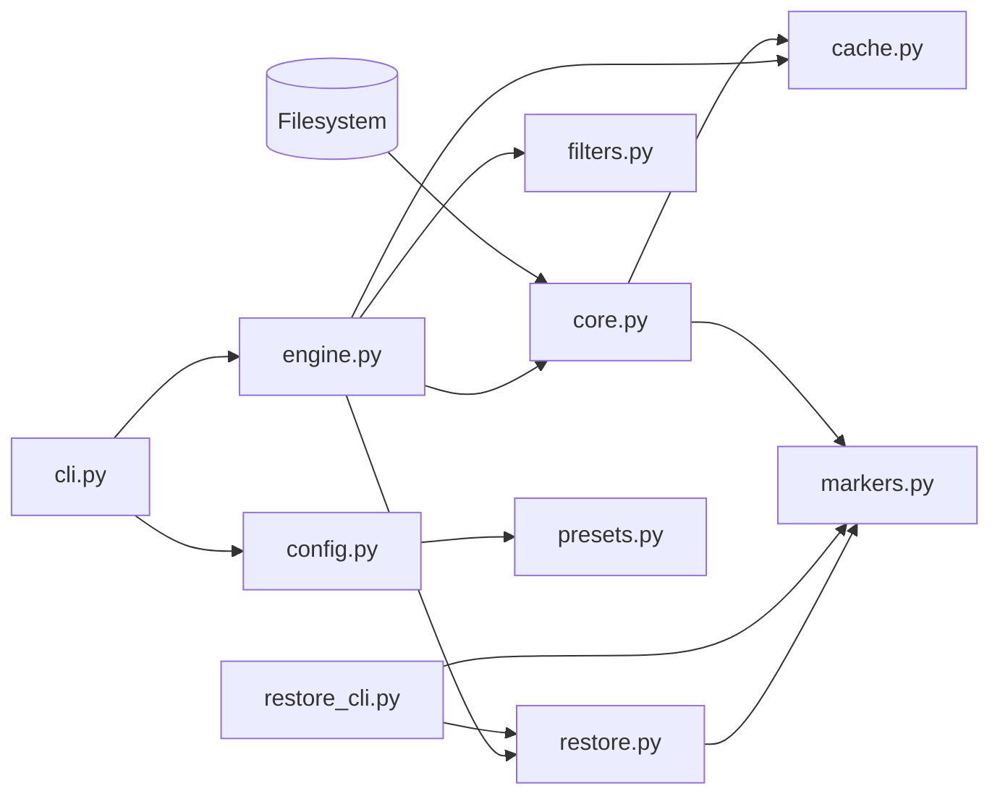
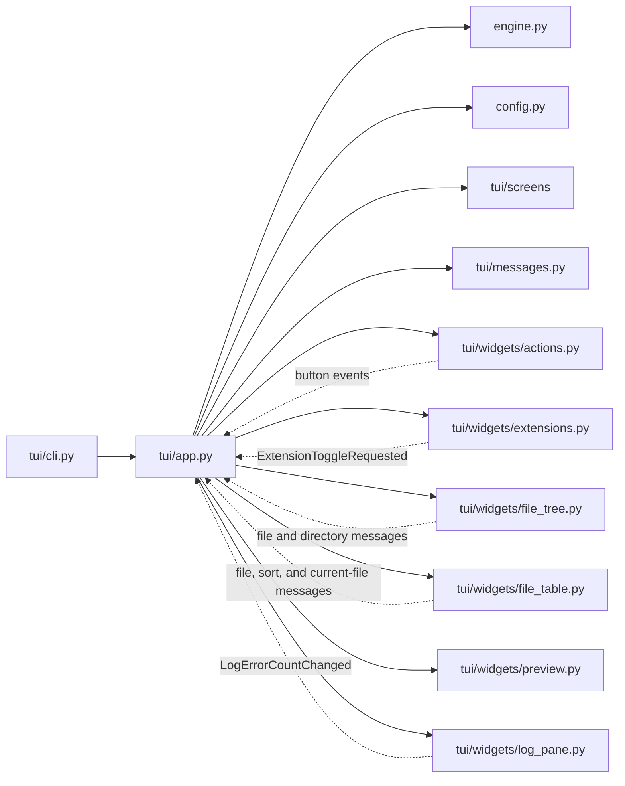
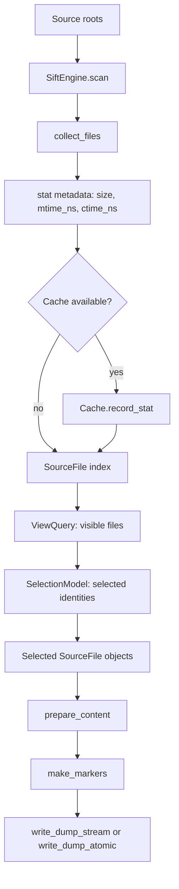

# Source package reference

This document describes the current `src/sift/` tree. Source line references
point to the implementation that establishes each contract. The package is
split into a presentation-independent scan and dump layer, configuration and
filter state, and a Textual interface.

## Architecture

### Headless and restore paths

`cli.py` imports configuration, core helpers, and `SiftEngine` (`cli.py:9-21`).
`SiftEngine` imports core, cache, filters, and restore (`engine.py:10-21`).
`core.py` imports cache and marker construction (`core.py:19-21`).
`restore_cli.py` calls `restore_dump` and reads dump entries through markers
(`restore_cli.py:9-10`).

### TUI path

`SiftApp.compose` creates the filter row, the Extensions pane, four center tabs,
and the Actions pane (`tui/app.py:93-121`). The app starts a scan worker and
rebuilds the extension, tree, and table views when it receives scan completion
(`tui/app.py:125-159`, `tui/app.py:169-178`).

### Boundaries

`engine.py` is presentation-agnostic. Its imports at `engine.py:5-21` contain
no Textual names. The `tui/` package is the only source subpackage that imports
Textual; for example, `tui/app.py:8-23` and `tui/widgets/file_table.py:5-6`
import the framework.

`core.py` does not import `SiftEngine`, `ViewQuery`, or `SiftConfig`; its import
block at `core.py:5-21` contains standard-library modules plus `Cache` and
marker construction. The engine owns scan lifecycle and filter/selection
models, while the TUI app coordinates presentation widgets and engine calls
(`engine.py:42-65`, `tui/app.py:65-89`).

The app acts as the message router. It handles file, directory, extension,
current-file, table-sort, and log-error-count messages (`tui/app.py:407-440`).
Widgets post domain requests rather than directly changing selection state;
the file tree and table use `FileToggleRequested`, `DirectoryToggleRequested`,
and `CurrentFileChanged` (`tui/widgets/file_tree.py:283-289`,
`tui/widgets/file_tree.py:345-363`, `tui/widgets/file_table.py:183-199`).

## Module reference

### `__init__.py`

The package initializer exposes the package version as `0.0.1` through
`__version__` (`__init__.py:1-3`). Project entry points are separately
declared in `pyproject.toml:13-17`.

### `core.py`

`SourceFile` carries the physical path, scan root, root-relative path, size,
`mtime_ns`, and `ctime_ns` (`core.py:122-141`). `collect_files` walks roots
with `os.scandir`, obtains metadata with `follow_symlinks=False`, filters
directories and files, records metadata through an optional cache, and stores
the stat times in each `SourceFile` (`core.py:213-220`, `core.py:239-295`).
It excludes non-regular files and does not follow symlinks (`core.py:249-260`).

`prepare_content` runs documentation removal, comment removal, JSON
compaction, and safe leading-whitespace stripping in that order
(`core.py:825-843`). `strip_is_unsafe` prevents leading-whitespace stripping
for Python, YAML, Make, Markdown, and reStructuredText suffixes and Makefile
names (`core.py:76-104`). For those paths only the whitespace-strip branch is
skipped; other requested transforms can still change the content
(`core.py:835-843`).

`is_binary` considers a file binary when its first 8192 bytes contain a NUL
byte (`core.py:107-119`). The preview calls this check before checking file
size, so a detected binary file receives the binary message even when it is
also over the preview size limit (`tui/widgets/preview.py:39-51`). The test
file `tests/test_binary.py` covers text, empty, PNG, missing, and probe-window
cases. `tests/test_strip.py` covers unsafe formats and a safe JavaScript case.

`write_dump_stream` obtains transformed content and delegates entry boundary
construction to `make_markers` (`core.py:857-875`, `core.py:919-928`). A
read error skips a file; a transform `ValueError` records a transform error
and writes the original content (`core.py:887-898`, `core.py:916-933`).
`write_dump_atomic` writes a temporary sibling file and replaces the target
after a completed stream write (`core.py:939-987`).

### `cache.py`

The cache schema constant is version 2 (`cache.py:12`). Its `files` table
stores path, size, `mtime_ns`, `ctime_ns`, inode, device, checksum, checksum
algorithm, and `last_seen` (`cache.py:14-31`). The `CachedEntry` fields mirror
the per-file data except `last_seen` (`cache.py:43-52`). The default database
path is computed from `XDG_CACHE_HOME`, falling back to `~/.cache`
(`cache.py:33-40`).

Each SQLite connection enables WAL, `synchronous=NORMAL`, and a 5000 ms busy
timeout (`cache.py:63-72`). The class contract says to create one connection
per thread and describes WAL's reader/writer purpose (`cache.py:55-61`).
`_ensure_schema` raises `RuntimeError` if the stored schema version differs
from version 2 (`cache.py:74-89`). `SiftEngine.scan` catches that
initialization error and continues without a cache (`engine.py:137-158`).

`record_stat` stores both nanosecond timestamps but retains a digest only if
size and `mtime_ns` match (`cache.py:97-122`). `lookup` also tests size and
`mtime_ns`, not `ctime_ns` (`cache.py:137-149`). `checksum_for` reuses a
matching stored SHA-256 or computes and stores a digest (`cache.py:157-174`).
Thus `ctime_ns` is recorded in the v2 schema but is not part of checksum
invalidation.

### `config.py`

The dataclasses define scan, dump, cache, restore, and key settings, including
defaults (`config.py:12-77`). `resolve_scan` resolves `presets=None` to the
`base` preset; explicit `presets=[]` resolves no preset names
(`config.py:83-102`). The `base` preset contributes directory excludes.
Explicit `include`, `exclude`, and `exclude_dirs` replace their corresponding
preset lists, while the `*_add` values append (`config.py:95-101`).

`load_config` reads user config, then the nearest `.sift.toml`, then applies
`SIFT_SCAN_PRESETS`, `SIFT_CACHE_PATH`, and `SIFT_NO_CACHE`
(`config.py:108-118`, `config.py:166-184`). CLI include/exclude options are
applied by `apply_scan_cli_overrides` and replace the current values while
clearing the matching additive list (`config.py:187-212`). The headless CLI
and TUI entry point both use that function (`cli.py:9-14`,
`tui/cli.py:8-10`, `tui/cli.py:55-61`).

### `presets.py`

`PRESETS` maps names to pure dictionaries with optional `include`, `exclude`,
and `exclude_dirs` lists (`presets.py:1`, `presets.py:12-21`). `base` only
defines directory exclusions. The language presets define include suffixes
or filenames. `resolve_scan` combines selected preset dictionaries before
applying explicit and additive configuration lists (`config.py:83-102`).

### `filters.py`

`ViewQuery` represents visibility through enabled extensions and a filter
expression (`filters.py:140-176`). `SelectionModel` stores selected file
identities independently of visibility (`filters.py:184-240`). Hiding a file
does not remove it from the selection set (`filters.py:191-208`); this is
covered by `tests/test_filters.py::test_hiding_does_not_deselect`.

Expressions are comma-separated, and a leading `!` makes a token an
exclusion (`filters.py:28-42`). A file must match an include when includes
exist and must not match an exclusion (`filters.py:47-59`). Filter expressions
implement `**/` as zero or more leading path segments and trailing `/**` as
descendants; `**` within a segment behaves as a single-segment wildcard
(`filters.py:70-85`). File discovery CLI patterns use plain `fnmatchcase`
(`core.py:204-210`).

### `engine.py`

`SiftEngine` is stateful with respect to scan results, not configuration
(`engine.py:42-65`). `scan` opens an optional cache, calls `collect_files`,
prunes unseen metadata, closes the cache, then initializes `ViewQuery` and
`SelectionModel` (`engine.py:137-161`). View and selection are initialized
empty with respect to selected identities (`filters.py:184-190`).

The engine's view-derived caches include `_visible_cache`,
`_files_under_cache`, `_dir_sizes`, `_dir_mtimes`, `_dir_ctimes`,
`_dirs_with_visible`, and `_dir_children` (`engine.py:55-65`). Rebuilding a
view cache aggregates file sizes and maximum file modification/change times
by directory (`engine.py:82-116`). A view change clears these maps and
`_dir_counts`; a selection change clears only `_dir_counts`
(`engine.py:69-80`, `engine.py:165-171`, `engine.py:222-250`).
`_dir_counts` is the pair `(visible file count, selected visible file count)`
per directory (`engine.py:118-135`).

Call `scan` before operations requiring initialized view and selection state;
`_require_scan` raises `RuntimeError` otherwise (`engine.py:259-262`).
`write_dump` selects the stream or atomic-file writer from its arguments
(`engine.py:264-286`), and the static `restore` method delegates to
`restore_dump` (`engine.py:288-290`).

### `markers.py`

`make_markers` uses the readable base markers when they do not appear in the
content. If either default marker collides, it appends an 8-hex-digit nonce
to the opener and closer and rejects attempted nonced markers found in the
content (`markers.py:9-50`). `iter_dump_files` yields path/content pairs and
raises `ValueError` for unterminated entries (`markers.py:53-72`).
`tests/test_markers.py` and `tests/test_roundtrip.py` cover marker parsing
and round trips.

### `restore.py`

`restore_dump` parses all entries, resolves each destination, and rejects a
destination outside the target root (`restore.py:22-34`). Unless overwrite
is enabled, it finds existing paths and raises before writing any entry
(`restore.py:36-42`). It then creates parent directories and writes UTF-8
content (`restore.py:44-47`). `tests/test_restore.py` covers traversal,
overwrite refusal, forced replacement, and basic restore.

### `cli.py` and `restore_cli.py`

`cli.py` defines the `sift` parser (`cli.py:26-86`), validates mutually
exclusive modes and required directories (`cli.py:89-107`), merges config
and CLI scan values (`cli.py:143-164`), then scans and emits a dump
(`cli.py:118-141`). Its `--restore` path calls the engine restore method
(`cli.py:115-125`).

`restore_cli.py` defines `sift-restore` with positional dump and target paths,
`--dry-run`, and `--force` (`restore_cli.py:13-28`). Dry run lists entry
paths without writing; normal mode calls `restore_dump`
(`restore_cli.py:31-48`). `pyproject.toml:13-17` exposes `sift`,
`sift-restore`, and `sift-tui` as console scripts.

## TUI package reference

### `tui/cli.py`

The TUI parser accepts roots and repeatable `--include`, `--exclude`, and
`--exclude-dir` arguments (`tui/cli.py:13-44`). `main` validates supplied
roots, loads config, applies those overrides, and launches `SiftApp`
(`tui/cli.py:47-64`). With no positional root, `SiftApp.on_mount` uses
configured roots or the current directory (`tui/app.py:125-141`).

### `tui/app.py`

`SiftApp.compose` arranges compact one-line filters above the main area. The
main area contains the left extensions pane, center tabs, and right actions
pane (`tui/app.py:93-121`; `tui/styles.tcss:11-15`). The center tabs are Tree,
Table, Preview, and Log. At terminal widths below 80, the app hides Extensions;
below 100, it hides Actions (`tui/app.py:137-140`).

The app routes domain messages from widgets to engine operations and refreshes
the affected views (`tui/app.py:407-440`, `tui/app.py:456-486`). File and
directory toggles update `SiftEngine`; extension toggles update the view
query (`tui/app.py:182-189`, `tui/app.py:410-421`, `tui/app.py:481-486`).
The app debounces view filtering and match-count refreshes (`tui/app.py:490-525`).

The `DUMP` action snapshots selected files and opens `DumpModalScreen` for the
output path (`tui/app.py:547-559`). Existing paths open
`OverwriteConfirmationScreen`; confirmation starts the dump worker
(`tui/app.py:599-668`, `tui/screens/overwrite.py:15-64`).

### `tui/messages.py`

The module defines `FileToggleRequested`, `DirectoryToggleRequested`,
`ExtensionToggleRequested`, and `CurrentFileChanged`
(`tui/messages.py:23-49`). The file and tree widgets post these requests;
the app handles them and updates its engine or preview
(`tui/widgets/file_table.py:183-199`, `tui/widgets/file_tree.py:283-289`,
`tui/app.py:407-425`). The file currently marked as `upcoming extraction` in
the message-module comment is already dispatched by the app. That comment is
listed under [Observations and UNKNOWNs](#observations-and-unknowns).

### Widgets

`ActionsPane` owns the four transform checkboxes and `DUMP` button
(`tui/widgets/actions.py:10-11`, `tui/widgets/actions.py:68-79`). The app reads
the checkbox state when it prepares `DumpOptions` (`tui/app.py:579-588`).

`ExtensionsPane` builds extension rows with selection counts and visibility
state. It posts `ExtensionToggleRequested` rather than changing the engine
(`tui/widgets/extensions.py:18-24`, `tui/widgets/extensions.py:51-84`,
`tui/widgets/extensions.py:127-146`). `styled_extension_row` supplies the
circle and dim/normal style (`tui/format.py:11-16`, `tui/format.py:54-76`).

`FileTreeView` stores expanded directories and renders root-relative
hierarchical rows with `Files`, `Length`, and `Modified` columns
(`tui/widgets/file_tree.py:56-89`, `tui/widgets/file_tree.py:93-180`). Its
header handler sorts by name, length, or modification time
(`tui/widgets/file_tree.py:365-377`). It posts file/directory toggle and
current-file messages (`tui/widgets/file_tree.py:283-289`,
`tui/widgets/file_tree.py:345-363`).

`FileTableView` shows up to 1000 visible files and has `Files`, `Length`,
`Modified`, and `Changed` columns (`tui/widgets/file_table.py:20-29`,
`tui/widgets/file_table.py:67-80`, `tui/widgets/file_table.py:109-125`). It
sorts by name, size, modification time, or change time and posts a
`SortChanged` message when a header is clicked (`tui/widgets/file_table.py:31-37`,
`tui/widgets/file_table.py:167-199`).

`PreviewPane` owns the current target, skips repeated loads of the same
`SourceFile`, shows a binary notice or an over-limit notice, and otherwise
reads UTF-8 with replacement for invalid byte sequences
(`tui/widgets/preview.py:11-17`, `tui/widgets/preview.py:33-58`). The maximum
preview size is 512 KiB (`tui/format.py:9`). The `w` binding toggles wrapping
(`tui/widgets/preview.py:60-62`, `tui/bindings.py:34-35`).

`LogPane` appends timestamped messages to the widget and, when its cache
directory is writable, to a rotating `session.log`; error entries post
`LogErrorCountChanged` (`tui/widgets/log_pane.py:25-31`,
`tui/widgets/log_pane.py:42-79`, `tui/widgets/log_pane.py:81-97`).

### `tui/bindings.py`, `tui/format.py`, and `tui/screens/`

`build_bindings` maps `KeysConfig` fields to app actions and adds a hard-coded
priority `ctrl+q` ignore binding (`tui/bindings.py:10-41`). `format.py`
contains marker, date, and size formatting helpers (`tui/format.py:11-96`).
The screen package exports `OverwriteConfirmationScreen`; the path-entry
`DumpModalScreen` is defined in `tui/screens/overwrite.py:66-114`
(`tui/screens/__init__.py:1-5`).

### `python_deps.py`

`python_deps.py` is absent from the current `src/sift/` tree. The `imports`
extra installs `grimp`, but `sift-deps` remains commented out in
`pyproject.toml:9-17`; this checkout contains no SIFT import-closure module or
entry point.

## Data flow

`SiftEngine.scan` owns collection, cache lifecycle, and initial model creation
(`engine.py:137-161`). `collect_files` captures stat metadata and calls
`Cache.record_stat` when caching is enabled (`core.py:239-295`). The view and
selection models are initialized after collection (`engine.py:159-161`).
Dump content is transformed before the per-file markers are written
(`core.py:825-843`, `core.py:919-928`).

## Tests linked to implementation

`tests/README.md` maps test files to modules. Current evidence includes
`test_cache.py` for checksum/stat handling, `test_engine.py` for directory
mtime aggregation, `test_binary.py` for binary detection, `test_strip.py` for
safe stripping, `test_tui_file_tree.py` and `test_tui_file_table.py` for the
views, and `test_tui_preview.py` for binary/size preview states.

## Observations and UNKNOWNs

### 6. Surprises

- `tui/messages.py:10-11` labels `FileToggleRequested` and
  `DirectoryToggleRequested` as upcoming extraction, but both are posted by
  widgets and handled by `tui/app.py:410-421`.
- `engine.py:137-158` catches a schema-mismatch `RuntimeError` during cache
  construction and continues without cache, so the old schema does not abort
  the normal scan path.
- `tests/conftest.py:32` says the fixture has three root-level `.py` files, but
  its setup writes two directly under `src/` (`tests/conftest.py:35-40`).
- `ScanConfig.presets=None` resolves to `base`, which contributes directory
  excludes but no file include pattern (`config.py:83-101`, `presets.py:12-20`).

### 7. UNKNOWNs

- Platform-specific timestamp and path semantics beyond this macOS test
  environment were not exercised.
