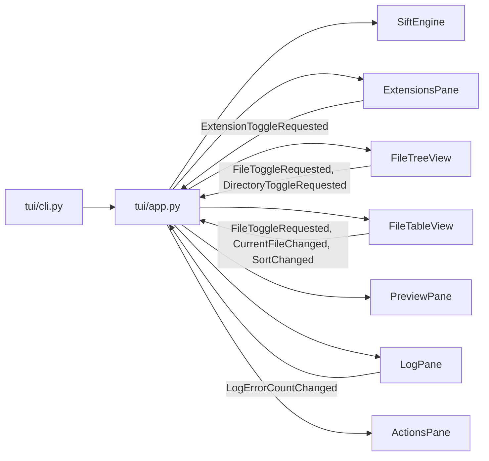

# TUI flow

`tui/cli.py` reads optional roots and repeatable scan filters, loads config,
applies CLI overrides, and starts `SiftApp` (`cli.py:13-64`). `SiftApp`
composes the compact filter row, left Extensions pane, center Tree/Table/
Preview/Log tabs, and right Actions pane (`app.py:93-121`).

The app starts a background scan and rebuilds its views after scan completion
(`app.py:125-178`). Widgets own their row, cursor, expansion, preview, or log
presentation state. They post domain messages when an operation needs to
change engine state; `SiftApp` handles those messages and refreshes the
relevant widgets (`widgets/file_tree.py:283-289`,
`widgets/file_table.py:183-199`, `app.py:407-440`).

`ExtensionsPane` groups visible files by extension and posts extension
visibility requests (`widgets/extensions.py:51-84`,
`widgets/extensions.py:127-146`). `FileTreeView` renders expandable
directories and files and posts file or directory selection requests
(`widgets/file_tree.py:93-180`, `widgets/file_tree.py:283-289`).
`FileTableView` displays up to 1000 visible files and posts sorting, selection,
and current-file messages (`widgets/file_table.py:20-37`,
`widgets/file_table.py:109-125`, `widgets/file_table.py:183-199`).

`PreviewPane` displays the highlighted file unless it detects a binary file or
a file larger than 512 KiB (`widgets/preview.py:33-58`). `LogPane` writes to
the visible log and, when possible, the cache directory's `session.log`
(`widgets/log_pane.py:42-79`). `ActionsPane` owns comment, docs, JSON, and
whitespace transform checkboxes plus the `DUMP` button
(`widgets/actions.py:68-79`).

The dump button opens `DumpModalScreen` for an output path. If that path
exists, `OverwriteConfirmationScreen` asks before replacing it
(`app.py:547-559`, `app.py:599-605`, `screens/overwrite.py:15-64`,
`screens/overwrite.py:66-111`). The app reads transform checkbox values,
builds `DumpOptions`, and delegates the write to `SiftEngine`
(`app.py:579-588`, `app.py:661-668`).

`tui/messages.py` declares file, directory, extension, current-file, sorting,
and log-count events. File and directory events are actively handled by the
app even though a module comment labels them as upcoming extraction
(`messages.py:7-11`, `app.py:407-440`).
